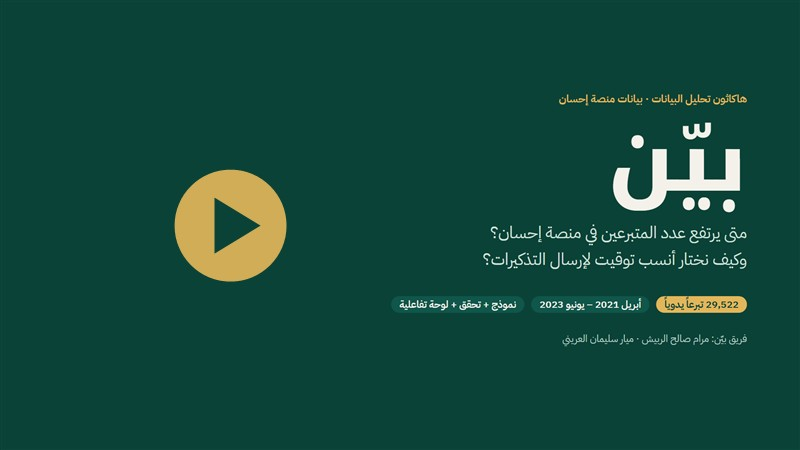
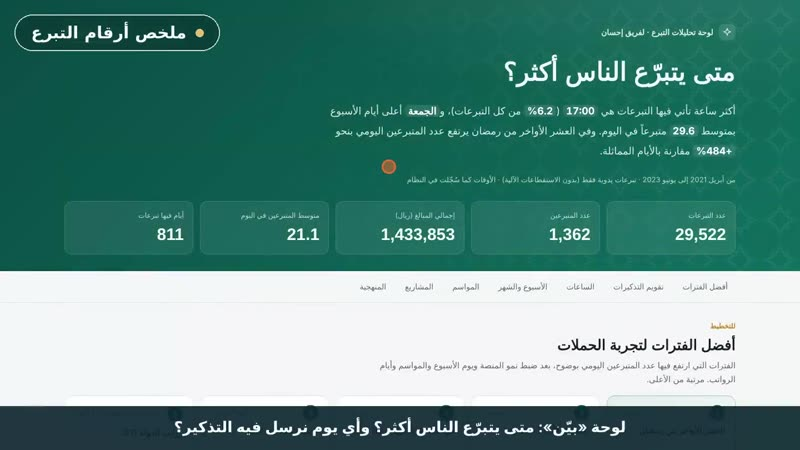

# بيّن: متى يرتفع التبرع في منصة إحسان؟

**فريق بيّن:** مرام صالح الربيش · ميار سليمان العريني

تحليل أوقات التبرع اليدوي في منصة إحسان (أبريل 2021 – يونيو 2023) لترشيح أفضل الأوقات لإطلاق الحملات وإرسال التذكيرات، مع لوحة تفاعلية لفريق إحسان.

- **اللوحة التفاعلية:** https://maramsaleh-anz.github.io/BayHack/ (الملف `index.html`)
- **تبويب «تقويم التذكيرات»** في اللوحة: أيام رمضان القادم والأشهر الـ12 القادمة بمضاعف متوقع لكل يوم ووقت الإرسال ونوع الرسالة، محسوبة من معاملات النموذج نفسه.
- **«كم تذكيراً في الشهر؟»** داخل التقويم: تختار عدد التذكيرات الشهرية فتُعلَّم أفضل الأيام، وتظهر كفاءة الرسالة مقارنة بتوزيعها على كل الأيام، مع زر **تنزيل جدول التذكيرات (CSV)** جاهز لنظام الإشعارات.
- **الملخص التنفيذي:** [`report/executive_summary.pdf`](report/executive_summary.pdf)
- **تقرير استخدام الذكاء الاصطناعي:** [`ai_usage_log.md`](ai_usage_log.md) ونسخة PDF في [`report/ai_usage_report.pdf`](report/ai_usage_report.pdf)

## الفيديوهات

### 1. العرض التقديمي

[](العرض%20التقديمي.mp4)

نعرض فيه المشكلة (متى نرسل رسالة التبرع؟)، وأهم اكتشاف وهو إن اختيار اليوم أهم من الساعة، وبعدها توصياتنا لإحسان.

▶️ [مشاهدة العرض التقديمي](العرض%20التقديمي.mp4)

### 2. شرح اللوحة التفاعلية

[](شرح%20اللوحة%20التفاعلية.mp4)

جولة سريعة على أفضل فترات التبرع، وتقويم التذكيرات، وتنزيل الجدول، وخريطة الساعات.

▶️ [مشاهدة شرح اللوحة](شرح%20اللوحة%20التفاعلية.mp4)

## أهم النتائج

| # | الفترة | الارتفاع في عدد المتبرعين اليومي | مدى الثقة ٩٥٪ |
|---|---|---|---|
| 1 | العشر الأواخر من رمضان | +484% | +410% إلى +569% |
| 2 | رمضان (الأيام 1–20) | +156% | +129% إلى +185% |
| 3 | ذو الحجة 1–9 (مع عرفة) | +153% | +100% إلى +221% |
| 4 | الجمعة (مقارنة بالأحد) | +54% | +39% إلى +70% |
| 5 | رواتب الدولة (يوم 27 + 3 أيام) | +26% | +12% إلى +41% |

- ساعة الذروة **17:00**، وأعلى خانة في الأسبوع **الجمعة 17:00–18:00**.
- في رمضان ذروتان: **السحور** و**قبيل الإفطار**.
- السبت أقل أيام الأسبوع، والعيدان لا يرفعان التبرع.

### اختبار التوقع: هل يختار النموذج الأيام الصحيحة؟

181 يوماً (يناير–يونيو 2023) لم يرها النموذج. النسبة = حصة المتبرعين في أعلى 10% من الأيام بحسب ترتيب كل طريقة (`outputs/tables/forecast_capture.csv`):

| الأيام | لو عرفنا المستقبل | نموذج بيّن | المواسم فقط | نفس اليوم الأسبوع الماضي | عشوائي |
|---|---|---|---|---|---|
| كل الأيام (181) | 31.3% | **30.7%** | 26.1% | 7.5% | 10% |
| الأيام العادية خارج المواسم (137) | 19.2% | **15.6%** | 10.2% | 11.8% | 10% |

معرفة المواسم وحدها تفسّر معظم النتيجة في كل الأيام، أما في الأيام العادية فيضيف النموذج قيمة واضحة (1.5 ضعف العشوائي).

النتائج علاقة في البيانات وليست دليلاً على السبب، وهي فترات مرشّحة للاختبار وليست أفضل وقت مثبتاً للإعلان (لا توجد بيانات حملات).

## هيكل المستودع

```
.
├── analysis.ipynb          # قصة التحليل خطوة بخطوة (خلايا قصيرة تستدعي الحزمة bayyin)
├── bayyin/                 # كود التحليل: وحدة صغيرة لكل غرض
│   ├── config.py           #   كل الاختيارات في مكان واحد: المسارات، المواسم، قواعد الصرف، إعدادات النموذج
│   ├── data.py             #   الخطوات 1–5: التنظيف وجدولا متبرع-يوم واليوم
│   ├── paydays.py          #   الخطوة 6: تقويم الصرف ونوافذه
│   ├── models.py           #   نماذج بواسون: الرواتب، المواسم، يوم الأسبوع، الفترات المرشّحة
│   ├── robustness.py       #   اختبار الثبات (9 متغيرات)
│   ├── forecast.py         #   نموذج التوقع
│   ├── hours.py            #   ساعة اليوم
│   ├── plots.py            #   الرسوم
│   └── pipeline.py         #   تشغيل كل شيء وحفظ الجداول  (python -m bayyin)
├── dashboard/
│   ├── src/                #   مصدر اللوحة: index.html (الهيكل) وcss/ وjs/ (ملف لكل غرض)
│   ├── prepare_data.py     #   يبني الجداول المجمّعة (ويشتق model_results.csv من الدفتر تلقائياً)
│   └── build.py            #   يجمع كل شيء في index.html مستقل
├── index.html              # اللوحة التفاعلية (ناتج البناء؛ لا يُعدَّل يدوياً)
├── data_clean/
│   ├── ehsan_rows_2021-04_2023-06.csv   # البيانات بعد التنظيف (فاصلة منقوطة ;)
│   └── dashboard_data/                  # الجداول المجمّعة التي تقرأها اللوحة
├── outputs/
│   ├── figures/            # رسوم الدفتر ولقطات اللوحة
│   └── tables/             # كل جداول النتائج (بدون معرفات المتبرعين)
├── tests/                  # اختبارات بايثون وJavaScript (تحمي الأرقام والقواعد)
├── pitch_deck/             # عرض المسابقة ونص الإلقاء
├── report/                 # الملخص التنفيذي وتقرير الذكاء الاصطناعي
├── requirements.txt        # المكتبات المطلوبة
└── Makefile                # أمر لكل مهمة
```

## طريقة التشغيل

```bash
pip install -r requirements.txt
python -m bayyin               # التحليل كاملاً: يكتب outputs/tables وoutputs/figures
python dashboard/build.py      # الجداول المجمّعة ثم index.html
```

**الدفتر:** افتح `analysis.ipynb` في Google Colab واختر `Runtime → Restart session and run all`؛ الخلية الأولى تنسخ المستودع (فيه الملف النظيف). ومن جذر المستودع محلياً يعمل مباشرة.

**اللوحة:** افتح `index.html` في المتصفح (يحتاج إنترنت لتحميل الخطوط ومكتبة d3). لتعديلها عدّل الملفات في `dashboard/src/` ثم شغّل `python dashboard/build.py`. تبويب «تقويم التذكيرات» منطقه في `dashboard/src/js/planner-core.js`، ويقبل `?today=YYYY-MM-DD` في الرابط لتثبيت تاريخ العرض.

**الاختبارات:**

```bash
pip install -r requirements-dev.txt
python -m pytest               # يعيد إنتاج كل الجداول من البيانات ويقارنها بالمحفوظة حرفاً بحرف
node --test                    # يقارن حساب التقويم في المتصفح مع hijridate وتقويم الصرف في بايثون
```

## المنهجية باختصار

1. استبعاد 10,981 استقطاعاً آلياً (وقته يحدده النظام لا المتبرع)، ودمج 45 نسخة مكررة، فبقيت 29,522 عملية من 1,362 متبرعاً.
2. تجميع البيانات إلى متبرع-يوم ثم جدول يومي (811 يوماً فيها بيانات).
3. نموذج بواسون لعدد المتبرعين اليومي يضبط يوم الأسبوع ونمو المنصة والمواسم الهجرية ونوافذ الرواتب معاً، مع أخطاء HAC.
4. تحقق ثانٍ مستقل لكل نتيجة؛ «ارتفاع واضح» فقط إذا اتفق النموذج والتحقق.
5. الساعات من وقت إنشاء العملية كما سُجّل (يُفترض بتوقيت السعودية).

استخدام الذكاء الاصطناعي موثّق في [`ai_usage_log.md`](ai_usage_log.md).
